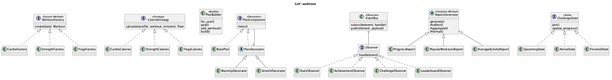

# Gof-fitnes-app

Фітнес-додаток для планування тренувань і відстеження прогресу (Flask, PostgreSQL, GoF-шаблони).

## Запуск
```bash
docker compose up -d db
python3 -m venv venv && source venv/bin/activate
pip install -r requirements.txt
cp .env.example .env
python run.py
```
Тести: `pytest`

Документація та UML-діаграми: [docs/](docs/)

## UML-діаграми
Зображення діаграм — у [docs/](docs/).

### Use Case


### Доменна модель


### GoF-шаблони


### Сервісний шар

