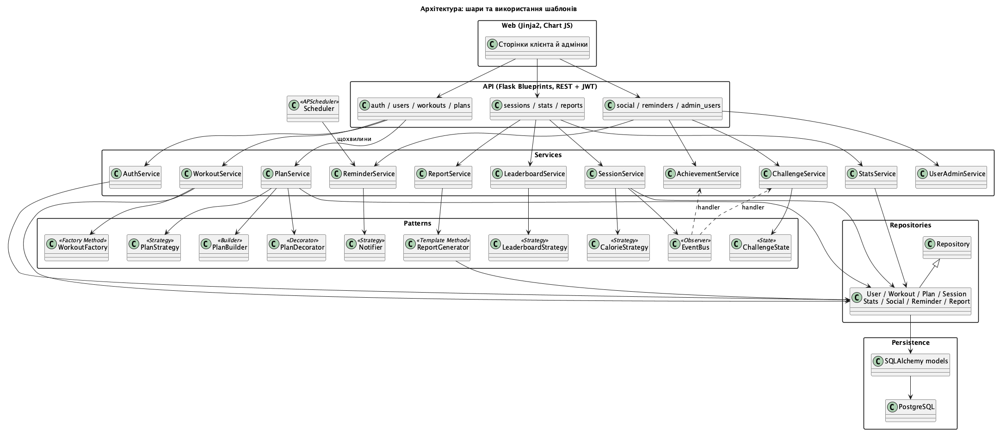
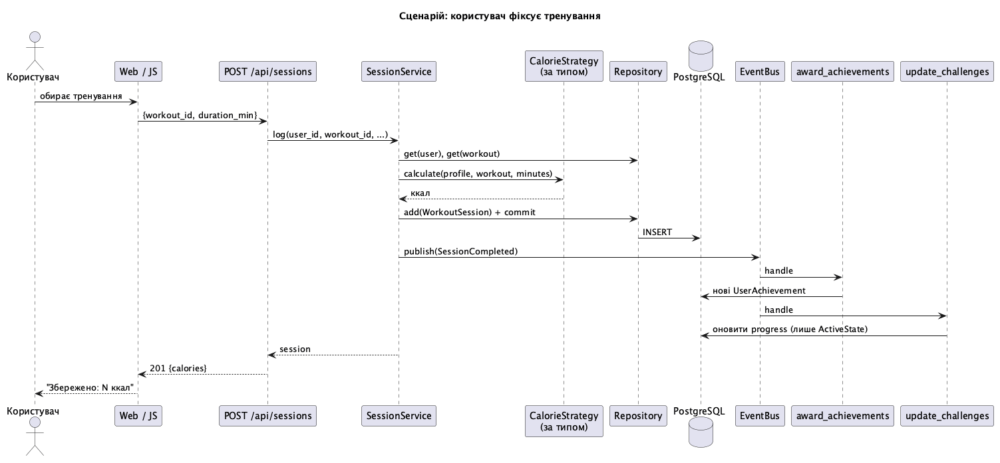
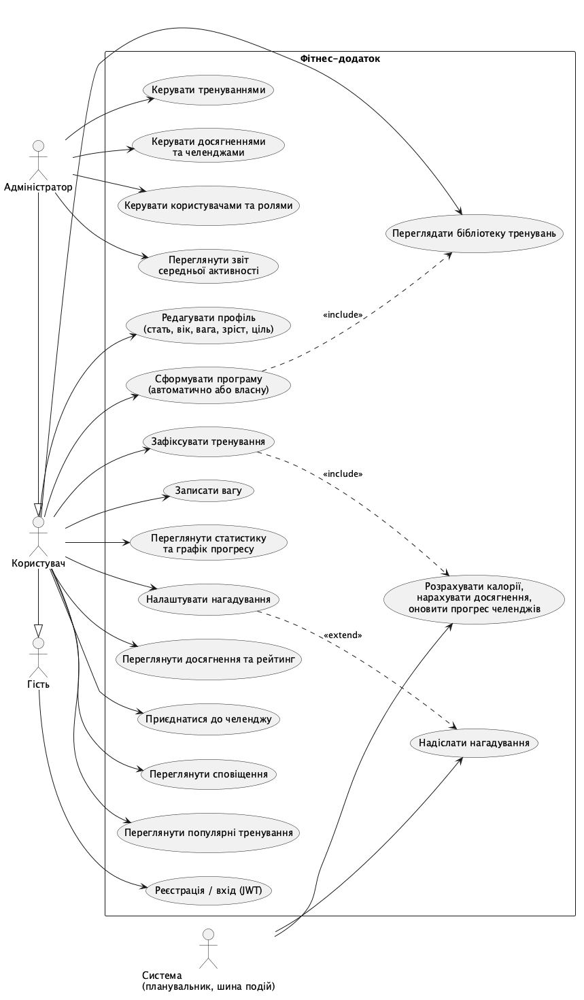
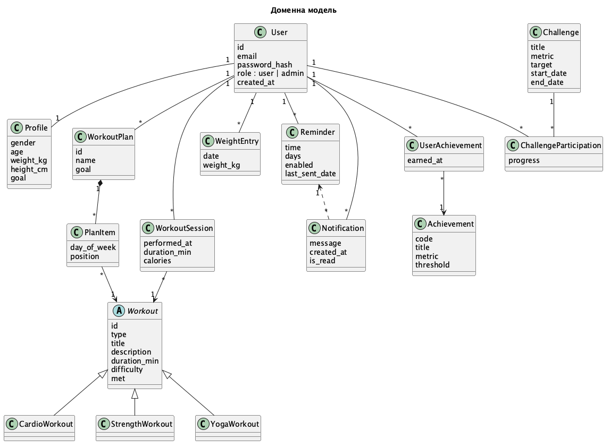
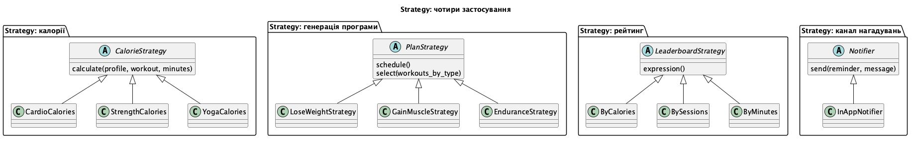
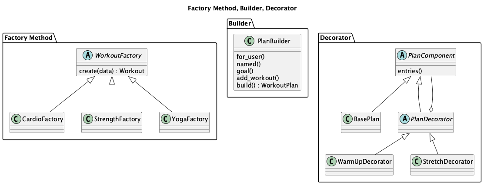
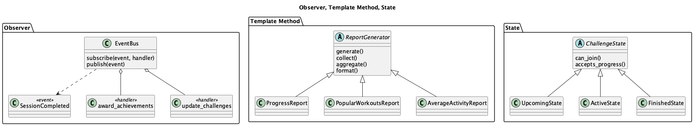

# FitTrack — фітнес-додаток (Gof-fitnes-app)

Веб-додаток для планування тренувань і відстеження прогресу. Курсова робота: ООП, GoF-шаблони, GRASP/SOLID, REST API, PostgreSQL, клієнтська та адмін-частини.

**Стек:** Python 3, Flask, SQLAlchemy + Flask-Migrate (Alembic), PostgreSQL, Flask-JWT-Extended, marshmallow, APScheduler, Jinja2 + Chart.js, pytest.

## Функціонал
- Реєстрація, вхід (JWT), профіль (стать, вік, вага, зріст, ціль).
- Бібліотека тренувань: кардіо, силові, йога.
- Індивідуальні програми: автоматична генерація за ціллю або власна, з опціональними розминкою й розтяжкою.
- Фіксація тренувань, розрахунок спалених калорій, запис ваги, статистика.
- Нагадування про тренування (планувальник) і сповіщення в застосунку.
- Соціальні функції: досягнення, челенджі, рейтинг.
- Звіти: графік прогресу, найпопулярніші тренування, середня активність користувачів за період.
- Адмін-панель: CRUD тренувань, досягнень, челенджів, керування користувачами й ролями, звіти.

## Швидкий старт
```bash
# 1. База даних (Docker) або будь-який локальний PostgreSQL з БД/користувачем fitness
docker compose up -d db

# 2. Залежності та конфіг
python3 -m venv venv && source venv/bin/activate
pip install -r requirements.txt
cp .env.example .env            # за потреби змініть DATABASE_URL

# 3. Схема БД і демо-дані
export FLASK_APP=run.py
flask db upgrade
python seed.py                  # адмін: admin@fitness.local / admin123 (лише для розробки)

# 4. Запуск
python run.py                   # http://127.0.0.1:5000
```
Тести (SQLite у пам'яті, планувальник вимкнено): `pytest`

## Архітектура
Шарова: **Web / API (Flask Blueprints, REST + JWT) → Services → Repositories → SQLAlchemy models → PostgreSQL**. Контролери тонкі, уся логіка в сервісах; сервіси залежать від абстракцій (стратегії, фабрики, репозиторій), а не від конкретних реалізацій (DIP, OCP). Помилки бізнес-логіки — `ServiceError`, що централізовано перетворюється на HTTP-відповідь.



## GoF-шаблони
| Шаблон | Де | Навіщо |
|---|---|---|
| Factory Method | [workout_factory.py](app/patterns/workout_factory.py) | створення тренувань за типом (кардіо/силові/йога) |
| Strategy | [calorie_strategy.py](app/patterns/calorie_strategy.py) | формула калорій за типом тренування |
| Strategy | [plan_strategy.py](app/patterns/plan_strategy.py) | правила тижневого розкладу під ціль (схуднення, маса, витривалість) |
| Strategy | [leaderboard_strategy.py](app/patterns/leaderboard_strategy.py) | метрика рейтингу (калорії, тренування, хвилини) |
| Strategy | [notifier.py](app/patterns/notifier.py) | канал доставки нагадувань |
| Builder | [plan_builder.py](app/patterns/plan_builder.py) | покрокова побудова та валідація `WorkoutPlan` |
| Decorator | [plan_decorator.py](app/patterns/plan_decorator.py) | розминка/розтяжка поверх програми без зміни даних |
| Observer | [event_bus.py](app/patterns/event_bus.py), [observers.py](app/patterns/observers.py) | реакція на `SessionCompleted`: досягнення та прогрес челенджів |
| Template Method | [report_generator.py](app/patterns/report_generator.py) | спільний каркас усіх звітів |
| State | [challenge_state.py](app/patterns/challenge_state.py) | фази челенджу (скоро / триває / завершено) |

Як вони взаємодіють у сценарії фіксації тренування:



## REST API (скорочено)
Усе під `/api`, крім `/auth/*` потрібен заголовок `Authorization: Bearer <token>`; `/admin/*` — лише роль admin.

| Група | Ендпоінти |
|---|---|
| Автентифікація | `POST /auth/register`, `POST /auth/login` |
| Профіль | `GET/PUT /users/me` |
| Тренування | `GET /workouts`, `GET /workouts/<id>`; admin: `POST/PUT/DELETE /admin/workouts` |
| Програми | `GET/POST /plans`, `POST /plans/generate`, `GET/DELETE /plans/<id>?warmup=1&stretch=1` |
| Сесії | `POST/GET /sessions` |
| Статистика | `GET /stats`, `GET /stats/progress`, `POST/GET /weight`, `GET /leaderboard` |
| Соціальне | `GET /achievements`, `GET /challenges`, `POST /challenges/<id>/join` |
| Нагадування | `GET/POST /reminders`, `PUT/DELETE /reminders/<id>`, `GET /notifications`, `POST /notifications/<id>/read` |
| Звіти | `GET /reports/progress`, `/reports/popular`, admin: `/reports/activity` |
| Адмін | `/admin/achievements`, `/admin/challenges`, `/admin/users` |

## Структура проєкту
```
app/
  api/            Flask Blueprints, marshmallow-схеми
  services/       бізнес-логіка
  repositories/   доступ до БД
  patterns/       GoF-шаблони
  models/         SQLAlchemy-моделі
  web/, templates/, static/   інтерфейс клієнта й адмінки
  scheduler.py    фонове завдання нагадувань (APScheduler)
migrations/       міграції Alembic
tests/            pytest
docs/             UML-діаграми
seed.py           демо-дані
```

## UML-діаграми
**Use Case**



**Доменна модель**



**Шаблони: Strategy**



**Шаблони: Factory Method, Builder, Decorator**



**Шаблони: Observer, Template Method, State**



## Примітки
- Час нагадувань рахується за локальним часом сервера.
- Під час debug-режиму планувальник працює лише в процесі-нащадку reloader'а; вимкнути його можна `SCHEDULER_ENABLED=0`.
- Chart.js підтягується з CDN (jsdelivr), тож для графіків потрібен інтернет.
